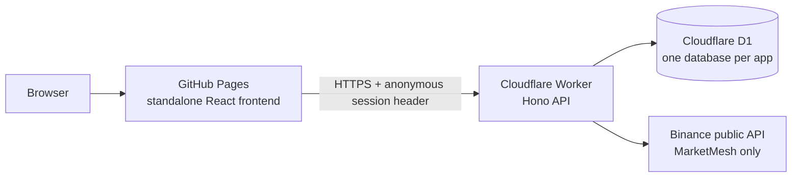

# Bamaboy101 — AI Automation Portfolio

Four independent, publicly deployed AI automation applications. Each one runs entirely on free-tier cloud infrastructure: **open a link and use it** — no login, no installation, no local server.

| Application | Live app | Source | What it does |
|---|---|---|---|
| **MarketMesh AI** | [Open →](https://bamaboy101.github.io/marketmesh-ai/) | [Repo](https://github.com/Bamaboy101/marketmesh-ai) | Multi-asset market watchlist with explainable RSI‑14 / moving-average signals and an auditable signal history |
| **AgentGuard AI** | [Open →](https://bamaboy101.github.io/agentguard-ai/) | [Repo](https://github.com/Bamaboy101/agentguard-ai) | Agent heartbeat monitoring, burst-failure incident detection, acknowledgement/resolution with an audit trail |
| **ActionFlow AI** | [Open →](https://bamaboy101.github.io/actionflow-ai/) | [Repo](https://github.com/Bamaboy101/actionflow-ai) | Turns pasted text or an uploaded PDF into reviewed, approved actions and a downloadable ICS calendar |
| **BusinessFlow AI** | [Open →](https://bamaboy101.github.io/businessflow-ai/) | [Repo](https://github.com/Bamaboy101/businessflow-ai) | Customer inquiry intake, intent classification, policy-grounded draft replies, approval/escalation with sandbox logging |

## Architecture



- **Frontend** — a single self-contained `apps/web/index.html` per app (React from CDN, Tailwind). No build step, so what is committed is exactly what is served.
- **Backend** — Cloudflare Workers running Hono, one Worker per application.
- **Storage** — Cloudflare D1 (SQLite), one isolated database per application.
- **CI/CD** — three independent GitHub Actions workflows per repo: `pages.yml` (publish frontend), `ci.yml` (API typecheck + unit tests), `e2e.yml` (headless Chromium against the **live public URL**, uploading screenshots and Playwright reports).

Frontend deployment is deliberately decoupled from backend tests, so a failing test can never take the public site down.

## Anonymous sessions and data isolation

Visitors are anonymous — there are no accounts. The Worker issues an opaque session id (UUID) which the browser keeps in `localStorage` and sends as `x-demo-session`. Every record is stamped with that id and every read is filtered by it, so **two different browsers never see each other's records**, while a reload keeps your own history.

Public abuse controls on every Worker: per-session rate limiting, a request-body size ceiling, an origin allowlist for CORS, and input validation on all write endpoints.

## What is real, and what is demonstration

| Real | Demonstration |
|---|---|
| Live Binance public market candles (MarketMesh) | Deterministic fallback candles when the upstream feed is unavailable — always labelled `demo-fixture` |
| Deterministic RSI‑14 / MA-cross rules with evidence and input hashes | No LLM inference is claimed or used |
| Real PDF text extraction from text-based PDFs | No OCR for scanned/image PDFs |
| Real persistence in D1, real audit trails | BusinessFlow "sends" nothing: approvals are recorded to a sandbox log only |
| Real incident detection and dedupe | AgentGuard controls only seeded `svc-demo-*` services — never real infrastructure |

**No live trading. No brokerage actions. No customer email sending. No CRM mutation. No paid services.**

## Running locally

```bash
git clone https://github.com/Bamaboy101/<app>.git
cd <app>/apps/api && npm ci && npm test     # API unit tests
npx wrangler dev                            # API on :8787
# frontend: open apps/web/index.html via any static server
cd ../../e2e && npm ci && npx playwright install chromium && npx playwright test
```

## Verification

Each repository publishes its own evidence: GitHub Actions run history, Playwright HTML reports, desktop + mobile screenshots, and network/console diagnostics captured against the public deployment. See the README in each repository for its current results and limitations.

## License

MIT — see each repository.
